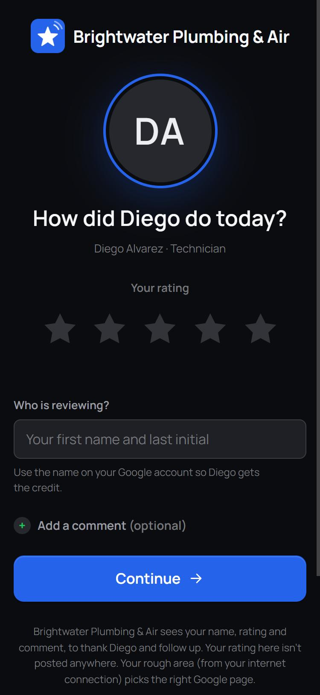
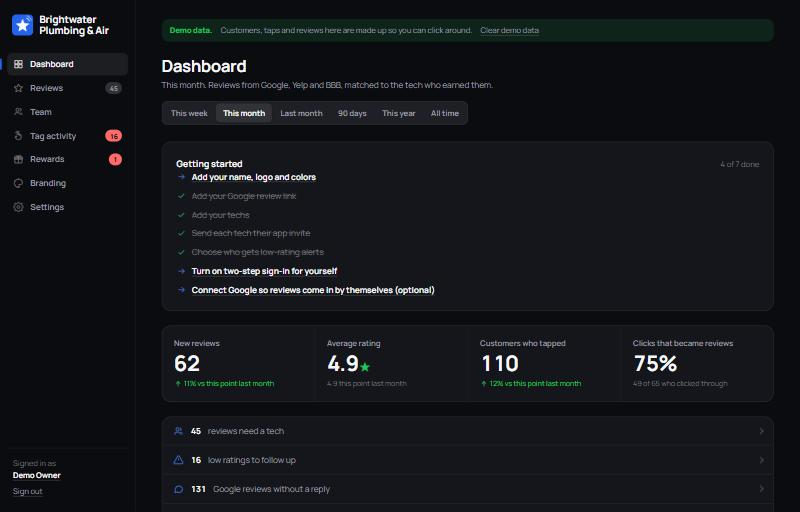
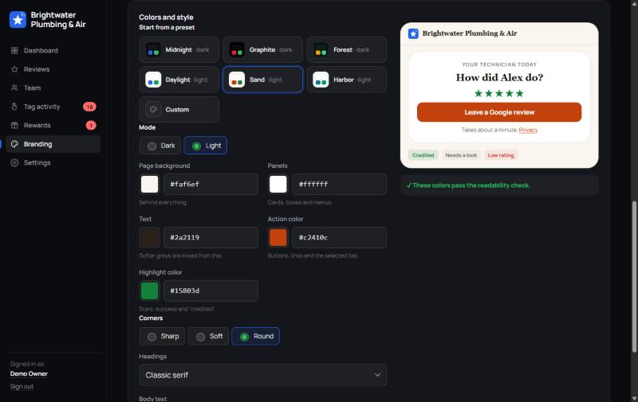
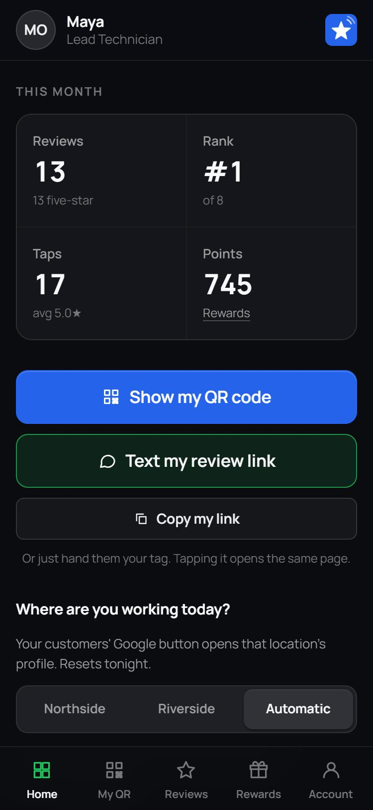

# RootView

**Self-hosted review tracking for field-service teams.** Every technician gets their own NFC tag or QR code. A customer taps it, rates the visit, and picks where to leave a public review. When the review shows up on Google, RootView works out which tech earned it and credits them, with points they can trade for rewards.

It's built for plumbers, electricians, HVAC, cleaners, locksmiths, landscapers, or any business whose people go to the customer. It runs on Cloudflare's free plan, has no monthly fees, and keeps your customers' data in your own account.

[](https://github.com/r0ottrek/RootView/actions/workflows/ci.yml)


| | |
|---|---|
|  |  |
|  |  |

---

## What you get

- **A page per tech.** The tech's tag or QR code opens a page with their photo. The customer rates the visit and types their name, and Google, Yelp, BBB or Facebook is one tap away.
- **Reviews matched to the right person.** Google never says which link a reviewer came from, so RootView matches on the name the customer typed, how soon the review followed the visit, and whether the review names the tech. Sure matches are credited automatically; likely ones wait for one click. [How it works](#how-a-review-gets-credited).
- **A separate app for techs.** Each tech signs in with their own username and password to see their reviews, leaderboard rank, QR code and points, and to request rewards. They can't see the office dashboard or anyone else's customers.
- **An office dashboard.** Shows reviews per week, a leaderboard, conversion from tap to review, and low ratings to call back. You can reply to Google reviews (with optional AI drafts) and run a rewards catalog.
- **Your brand, set up in the browser.** Upload a logo and app icon, choose a preset or any colors you like, and pick corner style and fonts. A live preview and a built-in readability check show the result. No code needed.
- **Several locations.** With two or more Google profiles, each customer is sent to the profile for where the job was.
- **Honest by design.** Every customer sees the review links, whatever rating they give. Hiding them from unhappy customers ("review gating") breaks Google's rules. Unhappy customers are also offered a call-back, so the office can make it right.

## Who signs in where

| Address | Who | What they can do |
|---|---|---|
| `/<tech>` (e.g. `/maya?s=nfc`) | Customers | Rate the visit and choose a review site. No account needed. |
| `/` | Customers | "Who helped you today?" search, for a company-wide QR code |
| `/me` | **Technicians** | Their own reviews, rank, QR code, points and rewards. Separate login. |
| `/admin` | **Office managers** | Reviews, credit, follow-ups, team, tag activity, reward requests |
| `/admin` | **Owners** | All of the above, plus settings, branding, Google, office logins, activity log and privacy requests |

---

## Try it on your computer (5 minutes)

You need [Node.js](https://nodejs.org) 22.13 or newer.

```bash
git clone https://github.com/r0ottrek/RootView.git rootview
cd rootview
npm install
cp .dev.vars.example .dev.vars
```

Open `.dev.vars` and fill in `SETUP_KEY`, `CRON_SECRET` and `DEMO_ADMIN_PASSWORD`. Any long random strings will do; this command makes one:

```bash
node -e "console.log(require('crypto').randomBytes(24).toString('base64url'))"
```

Then start the preview with made-up demo data, for a company called "Brightwater Plumbing & Air":

```bash
npm run dev:demo
```

Open http://localhost:8787:

- **Office:** http://localhost:8787/admin, signing in as `owner@demo.test` with your `DEMO_ADMIN_PASSWORD`.
- **Tech app:** http://localhost:8787/me/login, signing in as `maya` with the same password.
- **Customer page:** http://localhost:8787/maya

To start empty instead, run `npm run dev -- --reset` and open http://localhost:8787/setup.

> The local preview runs the real app on Node, with Node's built-in SQLite standing in for Cloudflare D1. It doesn't need Cloudflare's local runtime (which needs the Visual C++ Redistributable on Windows).

---

## Deploy to Cloudflare (free plan)

You need a free [Cloudflare account](https://dash.cloudflare.com/sign-up). All of this runs from the project folder.

**1. Sign in and create the database**

```bash
npx wrangler login
npx wrangler d1 create rootview
```

Copy the `database_id` it prints into `wrangler.jsonc`, replacing `00000000-0000-0000-0000-000000000000`. You can rename the project there too (`"name"`).

**2. Create the tables**

```bash
npm run db:migrate:remote
```

**3. Create the Pages project and set its secrets**

```bash
npx wrangler pages project create rootview --production-branch main
npx wrangler pages secret put SETUP_KEY
npx wrangler pages secret put CRON_SECRET
npx wrangler pages secret put ENCRYPTION_KEY
```

Each command asks for a value; paste a fresh random string for each. `ENCRYPTION_KEY` must be exactly 32 bytes, base64. Make one with:

```bash
node -e "console.log(require('crypto').randomBytes(32).toString('base64'))"
```

Keep a copy of `ENCRYPTION_KEY` somewhere safe. Without it, the stored Google connection and two-step sign-in keys can't be read.

**4. Deploy**

```bash
npm run deploy
```

It prints your address, normally `https://rootview.pages.dev`.

**5. Create your owner account**

Open `https://<your address>/setup`, enter the `SETUP_KEY`, and create the owner login. Setup closes for good once an owner exists.

**6. Turn on the 15-minute scheduler**

The scheduler imports Google reviews, retries missed alerts and clears out old data. Put your address in `cron/wrangler.jsonc` (`APP_URL`), then:

```bash
npx wrangler secret put CRON_SECRET --config cron/wrangler.jsonc
npm run deploy:cron
```

Use the same `CRON_SECRET` value as in step 3.

**7. (Optional) Use your own domain**

Go to Cloudflare dashboard → Workers & Pages → your project → Custom domains → add, for example, `reviews.yourcompany.com`. If your DNS is somewhere else, add the one CNAME record Cloudflare shows you. Then set **Settings → Address written on tags** to that address **before** you write any NFC tags.

**Updating later:** pull the new code, then run `npm run db:migrate:remote` and `npm run deploy`.

---

## First steps in the app

The dashboard shows a "Getting started" checklist until these are done:

1. **Branding:** your business name, logo, app icon and colors.
2. **Settings → Review sites:** your Google review link. In Google Business Profile, "Ask for reviews" gives you this link. Yelp, BBB and Facebook are optional.
3. **Team → Add a tech:** for each tech. Their link (e.g. `/maya`) is also their username.
4. **Each tech's page → Make an invite link:** text or email it. The tech opens it once, chooses a password, and adds the app to their home screen.
5. **Write the NFC tags.** See [NFC tags](#nfc-tags). Each tech's page also has a QR code and a printable card.
6. **Settings → Alerts:** who gets emailed about low ratings.
7. **Your account → Two-step sign-in:** strongly recommended for every owner.
8. **Settings → Google Business Profile** (optional): so reviews come in by themselves.

---

## Branding and themes

Everything is under **Admin → Branding** (owners only):

- **Business details:** name, office phone (customers can tap to call it), website and privacy policy link.
- **Logo:** any PNG, JPEG, WebP or SVG. It's resized in your browser and shown in page headers, on printed cards and in the tech app.
- **App icon:** a square image. It becomes the browser tab icon, the home-screen icon of the tech app, and the mark beside your name when there's no logo. You choose its background color and padding.
- **Colors:** start from a preset (Midnight, Graphite, Forest, Daylight, Sand, Harbor), or choose your own:
  - page background, panels and text;
  - an **action color** for buttons and links;
  - a **highlight color** for stars and "credited".
- **Mode, corners and fonts:**
  - dark or light;
  - sharp, soft or round corners;
  - a modern sans, a classic serif, engraved capitals or the device's own font.

The preview updates as you change things, and a readability check warns when text would be hard to read (it uses the WCAG contrast guidelines). Every page uses the new look straight away: customer pages, the tech app, the dashboard and printed cards.

<details>
<summary>For developers: how theming works</summary>

The owner's choices are stored as one validated object (`src/lib/theme.ts`). Only `#rrggbb` colors and values from fixed lists are accepted. The server turns it into about 40 CSS custom properties: hover tints, borders, readable text colors on buttons, and so on. It serves them as `/theme.css`, versioned by a hash so browsers fetch a new copy only when the theme changes. `public/styles.css` uses only those tokens, never raw colors.

To add a preset, add an entry to `PRESETS` in `src/lib/theme.ts`. The tests check that every preset passes the readability check.

Uploaded images are re-encoded in the browser, checked by the server (type, magic bytes and size), stored in D1, and served from `/asset/*` with `Content-Security-Policy: sandbox` and `nosniff`. SVG files are converted to PNG or WebP first, so no SVG is ever served back.
</details>

---

## How a review gets credited

Every review is scored on three clues:

1. **Name.** The customer typed their name on the tech's page, and Google shows the reviewer's name. "Maria L." matches "Maria Lopez".
2. **Timing.** How soon after the tag visit the review was posted, and whether the customer pressed that site's button.
3. **Mention.** The review names the tech ("Maya was great"). Nicknames can be added for each tech.

A score of 80 or more credits the tech automatically. From 40 to 79, the review waits under **Reviews → Needs a tech** with a one-click "Credit Maya · likely" button. Every credit shows its evidence. A crew of two can share a review, and both techs get full credit.

The rules are in `src/lib/match.ts`, covered by `test/match.test.mjs`.

### Several locations

With two or more Google profiles (Settings → Locations), each customer's Google button opens the profile for where the job was. The first rule that applies wins:

1. **The tech's choice for today:** tech app → "Where are you working today?" It resets overnight.
2. **The customer's area:** Cloudflare reports a rough city and ZIP code for each visitor, with no pop-up. Cell data skips this step, because carrier locations are often wrong.
3. **The tech's home location:** Team → tech.
4. **The main location.**

Each location can add bonus points per review, which helps grow a newer profile.

---

## Connecting Google Business Profile (optional)

Without this, Google reviews can be added by hand. With it, they come in every 15 minutes, and you can post replies from the dashboard.

1. [Request Business Profile API access](https://developers.google.com/my-business/content/prereqs) for a Google Cloud project. It's free, and approval takes a few days.
2. In that project, enable:
   - My Business Account Management API
   - My Business Business Information API
   - Google My Business API
3. **OAuth consent screen:** choose **Internal** if you use Google Workspace. Otherwise choose **External** and **publish** the app; apps left in "Testing" lose access after 7 days.
4. **Credentials → Create OAuth client → Web application.** Authorized redirect URI: `https://<your address>/admin/google/callback`
5. Save the client ID and client secret:
   ```bash
   npx wrangler pages secret put GOOGLE_CLIENT_ID
   npx wrangler pages secret put GOOGLE_CLIENT_SECRET
   npm run deploy
   ```
6. In the app, go to **Settings → Google Business Profile → Connect Google**. Sign in with the Google account that manages your profiles, then tick the profiles to track.

Only profiles that the connected Google login manages can be imported. To add one, make that login a Manager on the profile (Business Profile → People and access).

## Email alerts (optional)

Low ratings, call-back requests and reward requests can be emailed to the office through [Resend](https://resend.com):

1. Verify your sending domain with Resend.
2. Set the secret:
   ```bash
   npx wrangler pages secret put RESEND_API_KEY
   ```
3. In the app, fill in **Settings → Alerts**.

Without this, alerts still show in the dashboard.

## AI reply drafts (optional)

Set `ANTHROPIC_API_KEY`, and the dashboard can draft replies to Google reviews. Someone always reads a draft before it posts. `AI_MODEL` overrides the default model. Drafting is limited to 30 per hour per office user.

## NFC tags

NTAG213 or NTAG215 stickers or cards work well, and are cheap in packs of 25 to 50. To write one:

1. Install an NFC writing app (NFC Tools is free on iPhone and Android).
2. Write a URL record with the tech's NFC link from their Team page.
3. Test it with a phone that isn't signed in.
4. **Lock** the tag. Locking is permanent and stops anyone rewriting it.

Each tech's page also has a QR code (download as SVG) and a printable business card and sticker in your colors.

---

## Security

Short version:

- separate logins for owners, office managers and technicians;
- passwords hashed with PBKDF2;
- optional two-step sign-in (authenticator app);
- invite links in place of shared passwords;
- every sign-in and public form rate-limited;
- CSRF protection on every form, and a strict Content Security Policy;
- secrets optionally encrypted at rest (AES-256-GCM);
- an activity log for owners;
- automatic clean-up of customer data.

Details, and how to report a vulnerability: [SECURITY.md](SECURITY.md).

**Locked out?** If you've lost the only owner's password or two-step device, run:

```bash
node scripts/owner-reset-link.mjs you@example.com https://reviews.example.com
```

It prints a one-time reset link, plus the single `wrangler` command that activates it with your Cloudflare login.

## Privacy

Customers see a short notice on the rating page saying what's collected and why. What's kept is limited:

- a customer's rough area for 30 days;
- a call-back number for 90 days after the follow-up closes;
- unfinished visits for 30 days.

Owners can find and delete a customer's data on request (Settings → Privacy). Set your own privacy policy link under Branding.

## Limits on the free plan

Cloudflare's free plan allows 100,000 requests a day and 5 GB of D1 storage. That's far more than a 50-tech company needs.

Each request may use at most 10 ms of CPU time, which is why password hashing defaults to 20,000 PBKDF2 rounds. On Workers Paid, set `PASSWORD_ITERATIONS=100000` (the most Cloudflare's Web Crypto allows). Existing passwords are upgraded the next time each person signs in.

---

## Development

```bash
npm run dev           # local preview at http://localhost:8787 (keeps data between runs)
npm run dev:demo      # same, with fresh demo data
npm test              # unit tests + an end-to-end run through the real app
npm run check         # TypeScript
npm run preview:dist  # build exactly what's deployed, and run it locally
```

| Folder | What's in it |
|---|---|
| `src/index.tsx` | Routes, security headers, CSRF guard |
| `src/routes/` | `public.tsx` (customers), `tech.tsx` (tech app), `auth.tsx` (setup and sign-in), `admin/*` (office) |
| `src/lib/` | Matching, location routing, Google, sessions and passwords, TOTP, encryption, theme, settings |
| `src/views/` | Layout and shared components (server-rendered JSX, no client framework) |
| `public/` | `styles.css` (token-based), `app.js` (progressive enhancement only), fonts, default icons |
| `migrations/` | D1 schema |
| `cron/` | The 15-minute scheduler Worker |
| `scripts/` | Local preview, demo data, Pages build, owner reset |

Stack: [Hono](https://hono.dev), server-rendered JSX, Cloudflare Pages and D1, and TypeScript. Every page works without JavaScript.

Contributions are welcome. See [CONTRIBUTING.md](CONTRIBUTING.md).

## FAQ

**Is asking customers for reviews allowed?**
Google allows it, as long as you don't offer incentives to customers and don't filter who gets asked. RootView shows the review links to everyone. Yelp asks businesses not to solicit reviews at all, so Yelp is off by default; turn it on knowing that.

**Do techs get rewarded for reviews?**
Yes. Techs earn points from your own rewards catalog, which is an internal staff incentive. Customers are never offered anything.

**Can techs give themselves points by tapping their own tag?**
Ratings on a tag earn 0 points by default, and staff phones signed in to the app aren't counted as visits.

## License

[MIT](LICENSE). Bundled fonts: Manrope and Cinzel, under the SIL Open Font License (`public/fonts/OFL-*.txt`).
